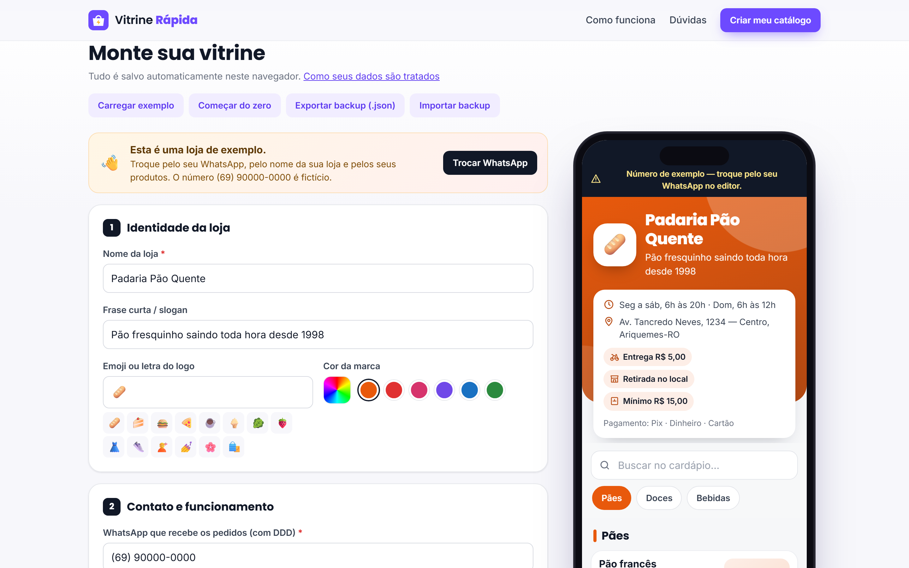
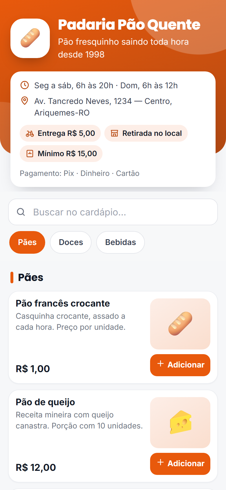
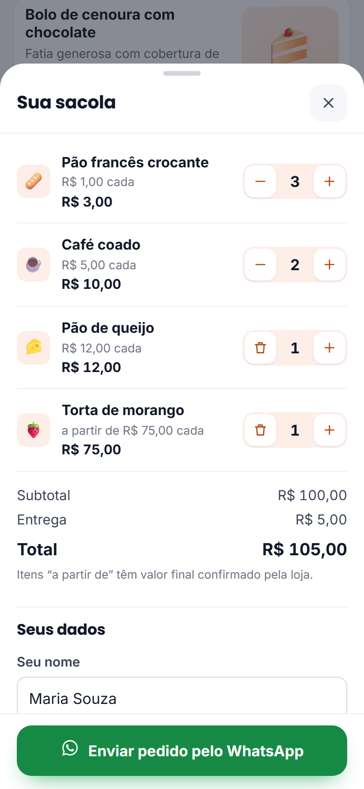

# Vitrine Rápida

**Catálogo e cardápio digital grátis, com pedidos pelo WhatsApp**, para o comércio local: padarias, lanchonetes, lojas de roupa, salões, hortifrútis.

O lojista monta o catálogo no navegador, compartilha um link ou QR code, e o cliente escolhe os produtos e envia o pedido já organizado para o WhatsApp da loja: itens, total, entrega, endereço e forma de pagamento.

- 100% grátis, sem cadastro e sem mensalidade
- Não tem servidor: os dados ficam no aparelho do lojista e dentro do próprio link
- Site estático, pronto para o GitHub Pages, sem etapa de build



| Vitrine no celular | Sacola e fechamento |
|---|---|
|  |  |

## Como funciona

1. **Monte o catálogo** em `index.html`: nome, slogan, emoji, cor da marca, WhatsApp, horário, entrega/retirada (com taxa), formas de pagamento, chave Pix, pedido mínimo, categorias e produtos (preço, "a partir de", esgotado, emoji e foto opcional). A pré-visualização no celular ao lado se atualiza enquanto você digita.
2. **Gere o link.** O catálogo vira JSON compacto, é comprimido com `CompressionStream('deflate-raw')`, codificado em base64url e vai no hash do endereço: `loja.html#d=z...`. Em navegadores sem compressão nativa, o link sai como JSON em base64url (prefixo `j`).
3. **Compartilhe** o link, o QR code ou o **cartaz pronto para imprimir** (PNG A5 em alta resolução, que também serve para A4).
4. **O cliente faz o pedido** em `loja.html`: busca, categorias, sacola, observações, entrega ou retirada, pagamento (com troco e chave Pix com botão de copiar). No fim, abre `https://wa.me/<número>?text=<mensagem>` com o pedido formatado em *negrito* do WhatsApp.

O editor salva tudo no `localStorage` e permite exportar e importar um backup `.json`. Também dá para voltar a editar uma loja colando o link dela em **Importar backup → Link da loja**.

## Privacidade

- O conteúdo depois do `#` **não é enviado** ao servidor que hospeda o site. O catálogo só existe no link e no navegador de quem o abre.
- **Qualquer pessoa com o link vê o catálogo inteiro.** Não coloque dados sensíveis (CPF, dados de clientes etc.).
- Os dados digitados pelo cliente (nome, endereço) só vão para a mensagem do WhatsApp. A sacola fica no `sessionStorage` da aba dele.

## Limites

- Cada alteração gera um **link novo**. QR codes já impressos continuam abrindo a versão antiga. A dica é usar um encurtador com destino editável. O editor aceita um link curto para gerar o QR e o cartaz.
- O link cresce com o catálogo. O editor avisa quando passa de ~6.000 caracteres e quando o QR fica denso demais (o máximo de um QR code é ~2.950 bytes).
- Não tem pagamento online nem controle de estoque: o lojista marca os itens esgotados manualmente.
- As fotos precisam ser links públicos (`https://`). Se uma imagem falhar, a vitrine mostra o emoji no lugar.

## Rodar localmente

Os módulos ES precisam de um servidor HTTP (abrir o arquivo direto com `file://` não funciona):

```bash
cd vitrine-rapida
python -m http.server 8000
# abra http://localhost:8000
```

Para publicar, envie a pasta para um repositório e ative o **GitHub Pages** (branch principal, pasta raiz). Não tem build.

## Estrutura

```
index.html            Landing + editor com pré-visualização
loja.html             Vitrine pública (lê o #d=...)
como-usar.html        Perguntas frequentes
assets/app.css        Estilos (editor, vitrine, FAQ, impressão)
assets/model.js       Modelo de dados, exemplo, validação de WhatsApp, dinheiro, cores
assets/codec.js       Compactação + compressão + base64url do link
assets/store-render.js Renderização da vitrine, sacola e mensagem do WhatsApp (compartilhado)
assets/loja.js        Inicialização da loja.html (link ou modo pré-visualização)
assets/editor.js      Editor, backup, link, QR e cartaz
assets/qr.js          Desenho do QR code e do cartaz em canvas
assets/vendor/        qrcode-generator (MIT) + NOTICE.txt
docs/screenshots/     Imagens para o portfólio
```

## Créditos e licenças

- Projeto desenvolvido por **[Nathan Kennedy](https://www.facebook.com/share/192dd6MgjS/)**, designer, editor de vídeo e programador.
- QR code: [qrcode-generator](https://github.com/kazuhikoarase/qrcode-generator) v1.4.4, © 2009 Kazuhiko Arase, licença MIT, incluído sem modificações em `assets/vendor/qrcode.js` (veja `assets/vendor/NOTICE.txt`). "QR Code" é marca registrada da DENSO WAVE INCORPORATED.
- Fontes: [Inter](https://rsms.me/inter/) e [Poppins](https://fonts.google.com/specimen/Poppins) via Google Fonts (SIL Open Font License).
- A "Padaria Pão Quente" do exemplo é fictícia, e o número (69) 90000-0000 não existe.
